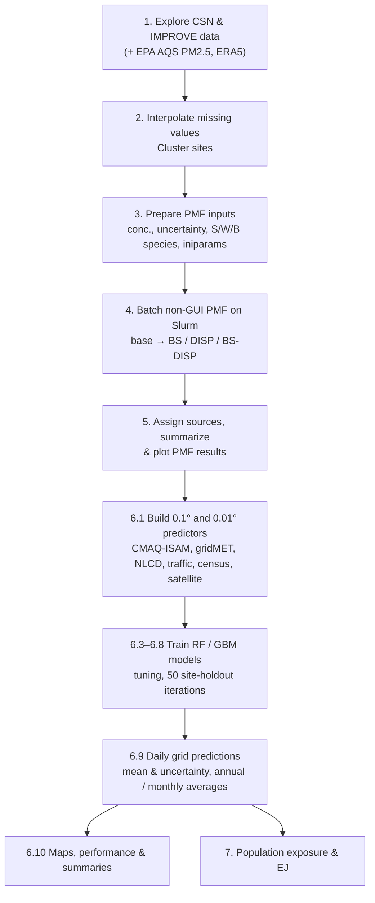

# HEI_PMF_nationalSA

National PM2.5 source apportionment for the contiguous United States, 2011–2020.

This repository contains the R, bash (Slurm) and Python scripts used to:

1. explore and clean daily PM2.5 speciation data from the **CSN** and **IMPROVE** monitoring networks;
2. fill missing values, cluster sites (for multi-site PMF analyses, sensitive analyses), and prepare inputs for **Positive Matrix Factorization (PMF)**, including dispersion-normalized PMF (DN-PMF);
3. run non-GUI EPA PMF in batch on an HPC cluster and summarize the resolved source factors; post-PMF plotting, and spatiotemporal trends analyses;
4. predict daily source contributions (traffic, dust, sulfate, nitrate, biomass burning / OA) and total PM2.5 on a **0.1° (~10 km) and 0.01° (~1 km) national grid** with machine-learning models (random forest and gradient boosting) using CMAQ-ISAM source tracers, meteorology, land use, traffic, satellite and census predictors; except for CMAQ-ISAM outputs, the rest predictors were separately downloaded and processed;
5. estimate population exposure and environmental-justice (EJ) disparities at census tract level.

---

## Contents

- [Workflow overview](#workflow-overview)
- [Data sources](#data-sources)
- [Software](#software)
- [Notes on running the scripts](#notes-on-running-the-scripts)
- [Scripts by step](#scripts-by-step)
  - [0. Shared functions](#0-shared-functions)
  - [1. Data exploration](#1-data-exploration)
  - [2. Missing-value interpolation and site clustering](#2-missing-value-interpolation-and-site-clustering)
  - [3. PMF input preparation](#3-pmf-input-preparation)
  - [4. Batch non-GUI PMF on the cluster](#4-batch-non-gui-pmf-on-the-cluster)
  - [5. PMF results: source assignment, summary and plots](#5-pmf-results-source-assignment-summary-and-plots)
  - [6. Predictor download and process, and gridded source prediction with machine learning](#6-gridded-source-prediction-with-machine-learning)
  - [7. Exposure and environmental justice](#7-exposure-and-environmental-justice)
  - [8. Other analyses](#8-other-analyses)
  - [Earlier versions and exploratory scripts](#earlier-versions-and-exploratory-scripts)
- [Other files](#other-files)
- [Contact](#contact)

---

## Workflow overview

Step numbers in the file names (e.g. `4.3.2`) match the steps in this README.

---

## Data sources

| Dataset | Used for | Link |
|---|---|---|
| CSN and IMPROVE daily PM2.5 speciation, 2011–2020 | PMF input | [Federal Land Manager Environmental Database](http://views.cira.colostate.edu/fed/QueryWizard/Default.aspx) |
| EPA AQS daily PM2.5 | Replacing / checking PM2.5 mass at CSN sites | [EPA AirData](https://aqs.epa.gov/aqsweb/airdata/download_files.html) |
| ERA5 boundary-layer height and 10 m wind | Dispersion normalization (DN-PMF); ML predictor | [Copernicus CDS](https://cds.climate.copernicus.eu/) |
| EPA SPECIATE v5.2 | Reference source profiles for factor identification | [EPA SPECIATE](https://www.epa.gov/air-emissions-modeling/speciate) |
| CMAQ-ISAM source-tagged PM2.5 & air pollutants (EGU, on-road, non-road, dust, biogenic, fires, sea salt, NO2, SO2, O3, etc.) | ML predictors | From the second part of the big project |
| gridMET daily meteorology | ML predictors | [gridMET](https://www.climatologylab.org/gridmet.html) (via Google Earth Engine) |
| NARR meteorology | Earlier predictor tests | [NOAA NARR](https://psl.noaa.gov/data/gridded/data.narr.html) |
| NLCD land cover | ML predictors | [MRLC NLCD](https://www.mrlc.gov/) |
| NOAA HMS smoke and dust plumes | ML predictors | [NOAA HMS](https://www.ospo.noaa.gov/Products/land/hms.html) |
| FHWA traffic volume (TMAS) | ML predictors | [FHWA](https://www.fhwa.dot.gov/policyinformation/tables/tmasdata/) |
| Road density ("roadiness") | ML predictors | [Roadiness](https://osf.io/mucs4/) |
| VIIRS night-time lights, MODIS NDVI, MAIAC AOD, elevation | ML predictors | [NASA](https://appeears.earthdatacloud.nasa.gov/task/area) |
| EPA Toxics Release Inventory (TRI) | Industry information | [EPA TRI](https://www.epa.gov/toxics-release-inventory-tri-program/tri-basic-data-files-calendar-years-1987-present) |
| US Census ACS (tract level) and TIGER geometries | Commute predictors; exposure and EJ analysis | [US Census ACS](https://www.census.gov/programs-surveys/acs) |

Raw and intermediate data are **not** included in this repository because of their size.

---

## Software

- **R** (4.3.x on the cluster). Main packages: `data.table`, `dplyr`, `tidyr`, `plyr`, `ggplot2`, `fst`, `sf`, `terra`, `raster`, `ncdf4`, `randomForest`, `caret`, `gbm`, `missForest`, `mice`, `imputeTS`, `doParallel`, `tidycensus`.
- **EPA PMF 5.0** (non-GUI / command-line version), run inside a Singularity container on the cluster.
- **Python 3** with `xarray`, `netCDF4`, `pandas` (ERA5 processing) and `earthengine-api` (gridMET download).
- **Slurm** workload manager on George Mason University's Hopper cluster. `6.2.1` / `6.2.2` check and install the R packages needed there.

---

## Notes on running the scripts

- **Step numbers are for bookkeeping only.** On the cluster, the scripts are used without the number prefix: for example, `4.3.1. Slurm_summary_outputs.sh` calls `Rscript summary_server_outputs.R`, which is `4.3.2 summary_server_outputs.R` in this repository.
- **Paired `.sh` and `.R` files.** Most steps from 4 onward have a Slurm job script (`.sh`) that submits an array job and passes arguments (source, year, iteration, etc.) to the R script with the same step number.
- **Paths are hard-coded.** Scripts point to local folders (Dropbox, `/Users/...`) or cluster folders (`/scratch/...`, `/projects/...`). Edit `setwd()` and the file paths before running.
- **Some numbers repeat or have gaps.** Several scripts share a step number when they were alternative or parallel versions of the same step. All versions are kept for record.
- **Naming used in file names**
  - `C` / `S`: cluster-based / site-based PMF; `F`: number of factors.
  - `Csub` / `noCsub`: with / without OC and EC sub-fractions.
  - `noExtreme`, `25TimesMean`, `15TimesMean`, `noSeason99`: ways of removing extreme concentrations.
  - `1mdl`, `0unc`, `VNi`, `AmmIon`: monthly MDL, no extra modeling uncertainty, V and Ni included, ammonium-ion species.
  - `DN`: dispersion-normalized PMF.
  - `HD`: holdout; `CV`: cross-validation; `AY` / `allYear`: models trained on all years (2011–2020) together.
  - `001`: 0.01° grid version (earlier versions used a 0.1° grid).

---

## Scripts by step

### 0. Shared functions

| Script | Description |
|---|---|
| `0. US_SA_functions.R` | Functions used across the project: plot themes and chemical-species labels, source colors, data-processing helpers (seasons, missing / negative rates, strong / weak species), PMF text-output parsing, and finding the task with the lowest Q value. |

### 1. Data exploration

| Script | Description |
|---|---|
| `1.1 Data exploration - CSN.R` | Explores CSN data and metadata: variables, MDLs, sampling and analysis methods, flags / qualifiers, and spatiotemporal trends of species concentrations. |
| `1.2 Data exploration - IMPROVE.R` | The same exploration for IMPROVE data. |
| `1.3 CSN & IMPROVE sites.R` | Finds co-located or nearest CSN and IMPROVE sites, compares their measurements, and prepares data for interpolation. |
| `1.4 US_Meteorology_ERA5_2011-20.ipynb` | Python notebook: converts hourly ERA5 boundary-layer height and u/v wind to daily values and wind speed for 2011–2020. |
| `1.5 EPA_PM_monitor.R` | Combines EPA AQS daily PM2.5, matches AQS monitors to CSN sites, and handles duplicate site-days. |

### 2. Missing-value interpolation and site clustering

| Script | Description |
|---|---|
| `2.1 PM_Comp_Interpolate.R` | Compares interpolation methods and fills missing species concentrations (CSN before / after 2015 separately), after replacing PM2.5 with AQS values. |
| `2.1.2 PM_Interpolate_lost_site.R` | Lists the sites dropped during interpolation and during non-GUI file preparation. |
| `2.2 PM_Comp_Clust_ML.R` | Clusters CSN and IMPROVE sites (separately) by species composition and other variables, used for sensitive analyses, multi- vs. single- site analyse. |

### 3. PMF input preparation

| Script | Description |
|---|---|
| `3.1 files_for_nonGUI.R` | Combines interpolated CSN data (before / after 2015), flags interpolated points, and prepares files for the concentration and uncertainty inputs. |
| `3.2 PMF_nonGUI_prepare.R` | Builds concentration and uncertainty inputs for GUI and non-GUI PMF: MDL handling, signal-to-noise, strong / weak / bad species, extreme values, and dispersion normalization. |
| `3.2.X PMF_notInterpolated_nonGUI.R` | Alternative input preparation using non-interpolated data. |
| `3.3 PMF_CMD_txt_fn.R` | Creates cluster / factor folders and writes `iniparams.txt` files for base, bootstrap (BS) and displacement (DISP) runs, for cluster-based PMF. |
| `3.4 PMF_CMD_txt_Site.R` | The same for site-based PMF, including sensitivity-analysis settings. |

### 4. Batch non-GUI PMF on the cluster

| Script | Description |
|---|---|
| `4.1.1 Slurm_PMF_from_base.sh` | Runs cluster-based PMF from the base run, then BS, DISP and BS-DISP. |
| `4.1.2 Slurm_PMF_bunch_select.sh` | Restarts cluster-based PMF from whichever step is missing or incomplete. |
| `4.1.3 minQ_Task_numoldsol.R` | Finds the base-run task with the lowest Q and updates `numoldsol` in the BS / DISP `iniparams.txt` files (cluster-based). |
| `4.1.4 Slurm_PMF_bunch_site.sh` | Site-based version of `4.1.2`, run in a Singularity container. |
| `4.1.5 minQ_Task_numoldsol_site.R` | Site-based version of `4.1.3`. |
| `4.3.1. Slurm_summary_outputs.sh` + `4.3.2. summary_server_outputs.R` | Count the output files per cluster / factor to check batch progress. |
| `4.3.3 Slurm_summary_outputs_site.sh` + `4.3.4 summary_server_outputs_site.R` | The same progress check for site-based runs. |
| `4.4.1 Slurm_base_disp_extract.sh` | Copies the base and DISP result files into a clean folder structure for download (cluster-based). |
| `4.4.2 Slurm_base_disp_extract_site.sh` | The same for site-based results. |

### 5. PMF results: source assignment, summary and plots

| Script | Description |
|---|---|
| `5.1 SPECIATE_expl.R` | Explores EPA SPECIATE profiles and matches species names to CSN / IMPROVE species, for reference source profiles. |
| `5.2 census_US_forPMF.R` | Prepares county-level industry (TRI), traffic and urban / rural information for interpreting sources. |
| `5.3 CMD_PMF_Base_mac.R` | Reads and plots cluster-based PMF outputs: Q values, bootstrap mapping, profiles and contributions. |
| `5.3.1 CMD_PMF_to_Conc_Site.R` | Converts site-based PMF outputs to source concentrations, across the different input settings. |
| `5.4 PMF_merge&plotting_cluster.R` | Merges cluster-based results and plots: combined PDFs, overall contributions, factor correlations. |
| `5.5 PMF_merge&plotting_site.R` | Merges site-based results and prepares information for manual source assignment. |
| `5.5.1 PMF_plotting_site_Csub.R` | Site-based plotting for runs with OC / EC sub-fractions. |
| `5.5.2 PMF_plot_CSN_IMP_source.R` | Main national figures combining CSN and IMPROVE results: daily, annual and seasonal source contributions, trends and maps. |
| `5.5.3 Final_plots_imp_csn.R` | Final source-profile figures comparing PMF and DN-PMF (example site). |
| `5.5.3 PMF_CSN_IMP_other_summary.R` | Summary tables: selected factor numbers, species used, strong / weak / bad species, extremes. |
| `5.5.4 PMF_results_check.R` | Checks that source profiles and daily contributions match after merging. |
| `5.5.5 No_15-18 PMF_plot_CSN_IMP_source.R` | Sensitivity check of trends when 2015–2018 are excluded. |

### 6. Gridded source prediction with machine learning

Predicts daily source contributions at 0.01° across the contiguous US. PMF source contributions at monitoring sites are the training targets.

#### 6.1 Predictor preparation

| Script | Description |
|---|---|
| `6.1 Source-related info.R` | Builds the 0.01° CONUS grid, and downloads / processes predictors: HMS smoke, EPA TRI, ACS census, NLCD, AQS pollutants, roadiness, NARR, FHWA traffic volume, topography and gridMET. |
| `6.1 Source_fhwa_trafficVol.sh` | Slurm job that interpolates FHWA traffic volume to daily grids (one task per year). |
| `6.1 gridmet_meteo_download.py` | Downloads daily gridMET variables for 2011–2020 via Google Earth Engine. |
| `6.1.1 CMAQ_file_download.sh` | Downloads monthly CMAQ-ISAM COMBINE and hr2day files. |
| `6.1.2 CMAQ_var_extract_from_org.R` + `6.1.2 CMAQ_var_org.sh` | Extracts CMAQ-ISAM variables from the NetCDF files and sets the grid projection. |
| `6.1.2 CMAQ_noBlowUp_process_month.R` | Processes CMAQ files month by month, avoiding memory blow-up. |
| `6.1.2.1 CMAQ_noBlowUp_missing.R` | Re-processes the months missing from `6.1.2`. |
| `6.1.2 Source_variables_0.01degree.R` | Single-file pipeline that grids all predictors to 0.01°: gridMET, NLCD + LCZ, elevation, road density, VIIRS lights, MODIS NDVI, MAIAC AOD, ERA5 BLH, HMS smoke / dust, FHWA traffic, CMAQ-ISAM, ACS commute. |
| `6.1.2 Souce_predictor_001.R` | The same pipeline with the cluster paths used in this project. |
| `6.1.3 CMAQ_var_merge_by_variable.R` + `6.1.3 CMAQ_var_to_annual.sh` | Merges CMAQ outputs by variable into annual files. |
| `6.1.4 ML_predictor_interpolaiton.R` | Projects / interpolates predictors onto the model grid. |
| `6.1.5 CMAQ_var_merge_by_source.R` | Merges CMAQ variables by PMF source and fills short gaps (geometric mean of neighboring days). |
| `6.1.5.1 Prepare PMF data.R` | Extracts source-specific PMF contributions and adds date information. |
| `6.1.5.2 Prepare CMAQ data.R` | Prepares CMAQ inputs for each source. |
| `6.1.5.2 CMAQ data trends.R` | Annual distributions and percentiles of CMAQ-ISAM variables. |
| `6.1.5.3 CMAQ_var_source_merge.R` | Joins CMAQ, PMF and other predictors by source. |
| `6.1.5.4 CMAQ_PMF_var_merge_001.sh` | Slurm array job for the merge, one task per month (0.01° version). |
| `6.1.6 CMAQ_US_extract_mainland.R` | Restricts model inputs to mainland-US grid points and adds date predictors. |
| `6.1.6.1 CMAQ_US_extract_mainland_allYear.R` + `6.1.6.1 CMAQ_US_extract_mainland.sh` | All-year version, run as an array by source and year. |
| `6.1.6 Combine_month_TrainTest.R` | Combines monthly train / test files for each source. |
| `6.1.6 File_total_PM.R` | Prepares the total PM2.5 input file. |

#### 6.2 Cluster environment

| Script | Description |
|---|---|
| `6.2.1 Hopper_R_package_check.sh` + `6.2.2 Hopper_R_pkg_check_install.R` | Check and install the required R packages on the cluster. |

#### 6.3–6.6 Single-year models (earlier stage)

| Script | Description |
|---|---|
| `6.3.1 RF_no_unc_noCoords_dust.R` + `6.3.1 RF_NO_unc_dust.sh` `6.3.2 RF_no_unc_noCoords_sulfate.R` + `6.3.2 RF_NO_unc_sulfate.sh` `6.3.3 RF_no_unc_noCoords_traffic.R` + `6.3.3 RF_NO_unc_traffic.sh` | Random-forest models per source and year, without coordinates as predictors. |
| `6.3.4 RF_noUnc_noCoords_model.R` + `6.3.4 RF_model.sh` | Generalized RF script run as an array over sources and years. |
| `6.3.5 ML_predictons_daily.R` + `6.3.5 ML_predictions_daily.sh` | Daily grid predictions from the trained models. |
| `6.3.6 ML_combine_CV_daily.R` + `6.3.6 ML_combine_CV_daily_predict.sh` | Combines daily predictions into annual files. |
| `6.4.1 GBM_no_unc_noCoords_dust.R` + `6.4.1 GBM_NO_unc_dust.sh` `6.4.2 GBM_no_unc_noCoords_sulfate.R` + `6.4.2 GBM_NO_unc_sulfate.sh` | Gradient-boosting versions for dust and sulfate. |
| `6.5.1 RF_holdout_noUnc_noCoords.R` + `6.5.1 RF_holdout_model.sh` | Site-holdout validation: 80% of sites for training, repeated over iterations. |
| `6.5.1 RF_holdout_with_unc_dust.R`, `6.5.2 RF_holdout_with_unc_sulfate.R` | Holdout models weighted by PMF uncertainty. |
| `6.5.2 ML_holdout_daily_prediction.R` + `6.5.2 ML_holdout_daily.sh` | Daily predictions from each holdout model. |
| `6.5.3 ML_combine_holdout_daily.R` + `6.5.3 ML_combine_holdout_daily_predict.sh` | Combines holdout predictions across iterations. |
| `6.5.4 ML_hold_train_test.R` + `6.5.4 ML_hold_train_test.sh` | Collects train / test predictions and predictor performance. |
| `6.6.1 MLresult_map_CV.R` + `6.6.1 ML_result_map_CV.sh` | Maps and performance metrics for CV results. |
| `6.6.2 ML_plot_Holdout.R` | Maps and performance metrics for holdout results. |
| `6.6.3 ML_plot_HD_metric.R` | Plots holdout performance metrics across sources and years. |

#### 6.7 All-year random forest (final models)

| Script | Description |
|---|---|
| `6.7 All_year_source_input.R` | Combines yearly inputs into one 2011–2020 file per source. |
| `6.7 All_year_source_combine.R` + `6.7 All_year_source_combine.sh` | Fills remaining predictor NAs with geometric means. |
| `6.7.1 allYear_ML_CV_model.R` + `6.7.1 allYear_ML_CV.sh` | All-year RF with cross-validation. |
| `6.7.2.0 allYear_ML_HD_parameter_detect.R` + `6.7.2.0 allYear_ML_HD_parameter_detect.sh` | RF hyperparameter tuning (`mtry`, `ntree`). |
| `6.7.2.1 allYear_ML_HD_parameter_combine.R` + `6.7.2.1 allYear_ML_HD_parameter_combine.sh` | Combines tuning results and selects the best settings by normalized RMSE and R². |
| `6.7.2 allYear_ML_Holdout_model.R` + `6.7.2 allYear_ML_Holdout.sh` | All-year RF with 50 site-holdout iterations (80% of sites for training). |
| `6.7.3 allYear_ML_CV_prediction.R` | Empty placeholder. |
| `6.7.4 allYear_ML_Holdout_prediction.R` + `6.7.4 allYear_ML_Holdout_prediction.sh` | Daily grid predictions from each holdout model, in 10-day blocks. |
| `6.7.4.2 All_year_daily_predict.R` | Daily prediction script for daily-file inputs. |
| `6.7.4.2 aY_ML_HD_001_daily_predict.R` | Daily prediction for the 0.01° grid (`001`), one input file per day. |
| `6.7.5 allYear_ML_Holdout_combine.R` + `6.7.5 allYear_ML_Holdout_combine.sh` | Combines predictions across iterations. |
| `6.7.5 allYear_ML_Holdout_combine_Rloop.R` | Loop version of the combine step. |
| `6.7.5.1 allYear_ML_HD_combine_byYear.R` | Combines predictions year by year. |
| `6.7.5.2 allYear_ML_HD_combine_joinOrgInput.R` + `6.7.5.2 allYear_ML_HD_combine_joinOrgInput.sh` | Averages daily predictions per grid point and joins them with the original inputs. |
| `6.7.5.3 allYear_ML_HD_select_PMF_CMAQ.R` | Keeps only the PMF / CMAQ / prediction columns needed downstream. |
| `6.7.6 allYear_ML_hold_train_test.R` + `6.7.6 allYear_ML_hold_train_test.sh` | Collects train / test predictions and variable importance across iterations. |
| `6.7.7 allYear_ML_train_test_plot.R` | Train / test performance plots (RF, GBM, CSN-only RF). |
| `6.7.8 allYear_HD_plot.R` | Combines averages across sources and maps estimates and uncertainty. |
| `6.7.9 allYear_HD_train-test_plot.R` | Annual comparisons and train / test performance plots. |

#### 6.8 All-year gradient boosting

| Script | Description |
|---|---|
| `6.8.1 AY_GBM_parameter_detect.R` + `6.8.1 AY_GBM_parameter_detect.sh` | GBM tuning over number of trees, interaction depth and shrinkage. |
| `6.8.2 AY_GBM_HD_model.R` + `6.8.2 AY_GBM_HD_modeling.sh` | All-year GBM with site-holdout iterations. |
| `6.8.3 AY_GBM_daily_prediction.R` + `6.8.3 AY_GBM_daily_prediction.sh` | Daily grid predictions from the GBM models. |

#### 6.9 Averaging and combining predictions

| Script | Description |
|---|---|
| `6.9.1 AY_average_daily_outputs.R` + `6.9.1 AY_average_daily_outputs.sh` | Overall, annual and monthly averages and uncertainty for each source and model. |
| `6.9.2 AY_average_inOne.R` + `6.9.2 AY_average_inOne.sh` | Stacks the single-source averages into one file per time period. |
| `6.9.3 AY_source_pred_inOne.R` + `6.9.3 AY_source_pred_inOne.sh` | Merges RF, GBM and CSN-only RF predictions into one dataset. |
| `6.9.4 allYear_ML_HD_annual_iter_001.R` | Daily mean prediction and uncertainty across the 50 iterations (0.01° grid). |
| `6.9.5 allYear_ML_HD_4day_001.R` | Extracts four selected days for daily maps. |
| `6.9.6 allYear_ML_HD_annual_monthly_001.R` | Day-weighted annual, calendar-month and whole-period averages (0.01° grid). |

#### 6.10 Final maps and summaries

| Script | Description |
|---|---|
| `6.10 AY_Prediction_Plot.R` | Overall spatial patterns and uncertainty for each source and model. |
| `6.10.1 AY_TrainTest_summary.R` | Train / test performance by site and iteration, and variable importance. |
| `6.10.2 AY_Prediction_annual_month_Plot.R` + `6.10.2 AY_Prediction_annual_plot.sh`, `6.10.2 AY_Prediction_month_plot.sh` | Annual and monthly prediction and uncertainty maps, for 0.1° predictions. |
| `6.10.3 AY_Prediction_Daily_Plot.R` + `6.10.3 AY_Prediction_Daily_Plot.sh` | Maps for four selected days, for 0.1° predictions. |
| `6.10.4 AY_Prediction_ym_ts_Plot.R` + `6.10.4 AY_Prediction_ym_ts_Plot.sh` | Year and month panels with mean ± SD across the grid, for 0.1° predictions. |
| `6.10.5 AY_TrainTest_Predictor_Correl.R` | Correlation among predictors (Pearson and Spearman, clustered heatmaps, dendrogram). |
| `6.10.6 AY_Pred_Unc_Map_001.R` + `6.10.6 AY_Pred_Unc_Map_001.sh` | 0.01° prediction and uncertainty maps: annual, monthly, overall, daily and by source. |
| `6.10.7 AY_Pred_Unc_summary_001.R` | US-wide summary statistics for every map from `6.10.6`, for 0.01° predictions. |

### 7. Exposure and environmental justice

| Script | Description |
|---|---|
| `7.1 Exposure_EJ.R` | Grid-level population exposure and population-weighted exposure (PWE) by source, nationwide and by census tract, compared across race and other ACS demographic groups. |

### 8. Other analyses

| Script | Description |
|---|---|
| `8.1 other_info_PMF.R` | US air-pollutant emission trends, and relationships between PMF source contributions and gridMET meteorology. |

### Earlier archieved versions and exploratory scripts

These unnumbered scripts are earlier versions or tests, kept for reference.

| Script | Description |
|---|---|
| `PMF_CMAQ_model_try.R`, `PMF_CMAQ_model_try2.R`, `PMF_CMAQ_model_try_3.R` | First tests linking PMF and CMAQ-ISAM, including a Keras neural-network trial. |
| `CMAQ_transfer.R` | First exploration of CMAQ-ISAM NetCDF files (hourly to daily). |
| `CMAQ_predicor_plot.R` | Maps of CMAQ predictors. |
| `CMAQ_run_time.sh` | Helper to test job run time on different nodes. |
| `Variable match by year.R` | Early matching of PMF, CMAQ and gridMET by year. |
| `RF_no_unc.R` + `RF_NO_unc.sh` `RF_with_unc.R` + `RF_with_unc.sh`, `RF_with_unc_dust.sh`, `RF_with_unc_sulfate.sh` | Early RF models with and without PMF uncertainty. |
| `RF_no_unc_noCoords_dust.R`, `RF_no_unc_noCoords_sulfate.R`, `RF_no_unc_noCoords_traffic.R` | Earlier copies of the step 6.3 scripts. |
| `GBM_no_unc.R` + `GBM_NO_unc.sh` | Early GBM model. |
| `AY_GBM_HD_parameter_detect.R` | Earlier copy of `6.8.1 AY_GBM_parameter_detect.R` (the name the Slurm job calls on the cluster). |
| `interpolation_IDW.sh` | Slurm job for IDW interpolation of road / commute data. |

---

## Other files

| File | Description |
|---|---|
| `us_grid_centroids_01.fgb` | Centroids of the 0.1° US grid (FlatGeobuf). |
| `HEI_PMF_nationalSA.Rproj` | RStudio project file. |
| `.gitignore` | Files Git ignores (R session files, `.DS_Store`). |

---

## Contact

Ting Zhang, George Mason University (tzhang23@gmu.edu)

This work was carried out as part of a Health Effects Institute (HEI) funded project on national PM2.5 source apportionment.
